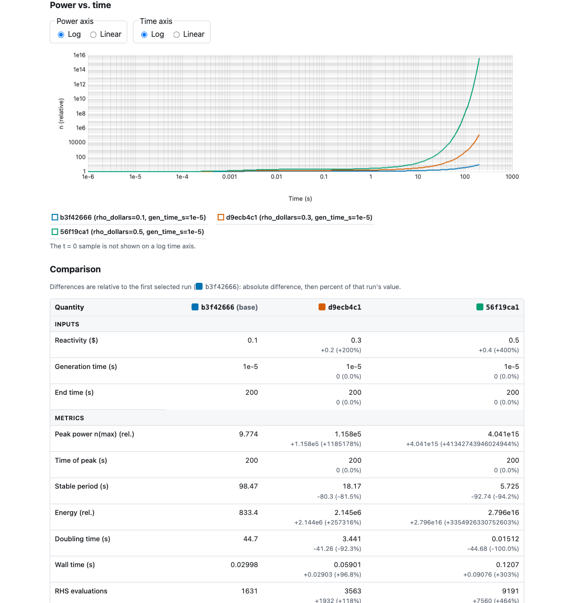
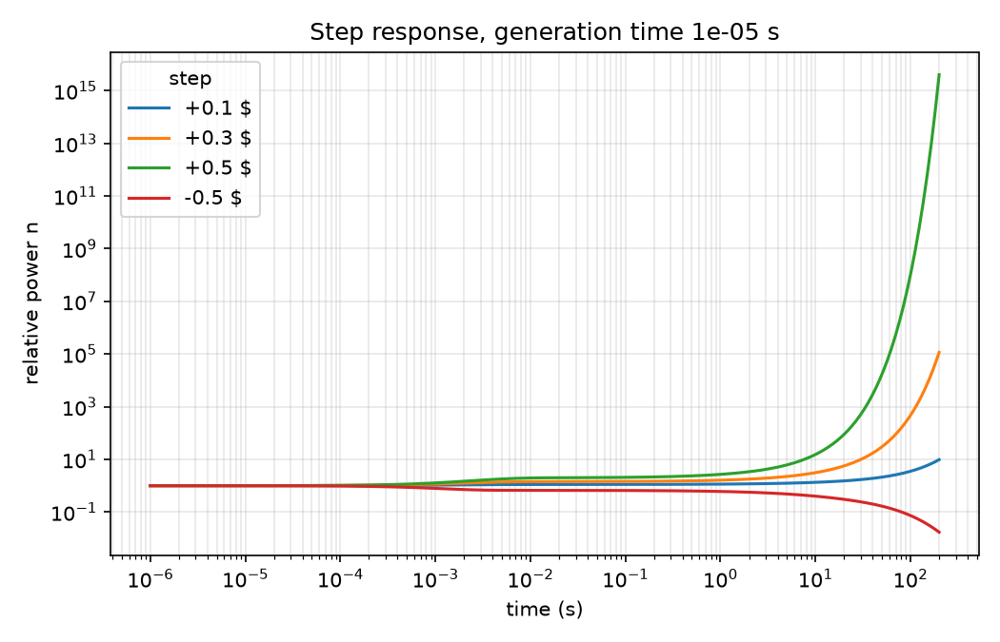
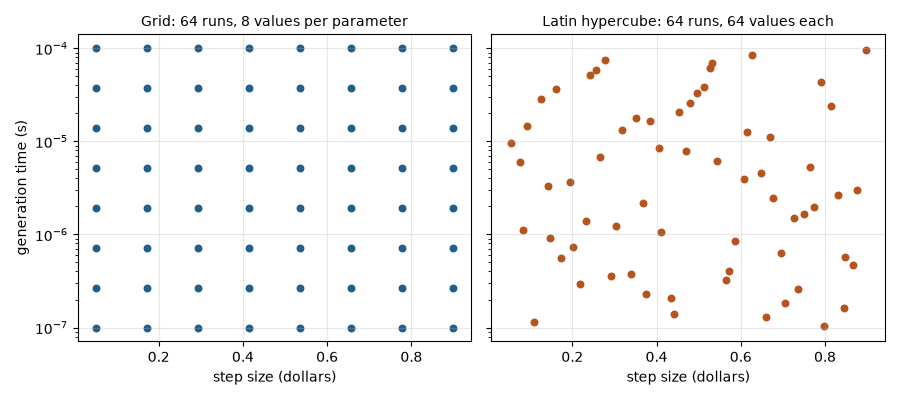

# Reactor Kinetics Sweep

[](https://github.com/jwwoody/reactor-kinetics-sweep/actions/workflows/ci.yml)
[](https://gitlab.com/jwoody/reactor-kinetics-sweep/-/pipelines)

A small Python package that simulates how a reactor's power changes over time after a change
in reactivity (the point-kinetics equations), runs that simulation across many parameter
combinations, stores the results in Parquet, checks itself in CI on every push, and shows the
results in a web page where runs can be compared side by side.

**This is an educational model.** It uses textbook equations and textbook data. It is not a
design or safety tool, and its numbers must not be used as one.



Compare page: <https://reactor.jeffreywoodbury.dev/> (published by CI from the
smoke sweep).

## Quick start

```bash
python -m venv .venv && source .venv/bin/activate
pip install -e ".[dev]"

rksweep run --rho-dollars 0.3 --gen-time 1e-5 --t-end 200    # one run, prints metrics
rksweep sweep configs/smoke.toml --out results/              # 9 runs -> Parquet
rksweep export results/ --out ui/public/data/                # JSON for the compare page

cd ui && npm ci && npm run dev                               # open the compare page locally
```

Python 3.11 or newer. `make lint`, `make test`, `make smoke`, `make golden` and `make export`
run the same commands CI runs.

## The model

Point kinetics treats the whole core as one point. With neutron population `n` (relative
power) and six delayed-neutron precursor groups `C_i`:

```text
dn/dt   = ((ρ(t) − β) / Λ) · n  +  Σ_i λ_i · C_i
dC_i/dt = (β_i / Λ) · n  −  λ_i · C_i          for i = 1..6
```

`ρ` is reactivity (`ρ/β` is reactivity in dollars), `Λ` the prompt generation time, `β_i` and
`λ_i` the delayed fraction and decay constant of each group. Runs start from steady state at
`n = 1`. Inputs are a step, a capped ramp, a sine, and a step with a lumped temperature
feedback (`ρ = ρ0 + α·T`, `dT/dt = K·n − T/τ`), which makes the power rise, peak and settle.
Inputs that reach `ρ ≥ β` (prompt critical) are refused by default.



### Data

Six-group delayed-neutron data for U-235 thermal fission, as tabulated in Keepin, *Physics of
Nuclear Kinetics* (1965) and reproduced in Duderstadt & Hamilton, *Nuclear Reactor Analysis*
(1976), ch. 6, with `β = 0.0065`. These are rounded textbook values, not evaluated nuclear
data. See [src/rksweep/constants.py](src/rksweep/constants.py).

### How the solver is checked

Every claim below is a test in [tests/test_kinetics.py](tests/test_kinetics.py).

| Check | What the test asserts |
|---|---|
| Data sanity | Abundances sum to 1, all `λ_i > 0`, `β = Σ β_i` |
| Steady state | With `ρ = 0`, `n` stays at 1 within 1e-9 for 100 s |
| Exact solution | For constant `ρ` the system is linear, so `x(t) = expm(A·t)·x(0)`. The ODE result matches it within 1e-6 relative at every output time for steps of $0.1, $0.5 and −$0.5 |
| Prompt jump | Just after the fast transient, `n ≈ β/(β − ρ)` within 3% |
| Stable period | The late-time slope of `ln n` matches the largest root of the inhour equation within 1% |
| Negative step | `n` decreases monotonically after the prompt drop |
| Property test | Hypothesis draws random steps in [−$1, +$0.9] and `Λ` in [1e-7, 1e-4]; the ODE matches `expm` and `n` stays positive |

The prompt-jump formula freezes the precursors, so it is only an approximation. One
combination ($0.5 with `Λ = 1e-4` s) is left out of that test because the precursors drift
about 9% before the fast transient ends there.

### Solver choice, measured

The fastest time scale is about `Λ/β` and the slowest about `1/λ_1 ≈ 80 s`, so the problem is
stiff. Measured with [benchmarks/solver.py](benchmarks/solver.py): a $0.3 step,
`rtol = 1e-8`, `atol = 1e-12`, best of 3, on 2026-11-16 (Apple M3 Pro, Python 3.11.6,
NumPy 2.4.6, SciPy 1.17.1).

| Case | Method | Jacobian | t_end (s) | Wall (ms) | Steps | nfev | njev |
|---|---|---|---:|---:|---:|---:|---:|
| thermal, Λ=1e-5 s | RK45 | n/a | 200 | 1037.6 | 27553 | 192788 | 0 |
| thermal, Λ=1e-5 s | Radau | analytic | 200 | 43.6 | 507 | 3563 | 2 |
| thermal, Λ=1e-5 s | Radau | finite diff | 200 | 44.2 | 507 | 3563 | 2 |
| thermal, Λ=1e-5 s | BDF | analytic | 200 | 22.9 | 442 | 886 | 1 |
| thermal, Λ=1e-5 s | LSODA | analytic | 200 | 6.2 | 601 | 1047 | 49 |
| fast, Λ=1e-7 s | RK45 | n/a | **2** | 1032.6 | 27520 | 192572 | 0 |
| fast, Λ=1e-7 s | Radau | analytic | 200 | 44.8 | 524 | 3689 | 2 |
| fast, Λ=1e-7 s | BDF | analytic | 200 | 21.3 | 457 | 916 | 1 |
| fast, Λ=1e-7 s | LSODA | analytic | 200 | 4.8 | 459 | 833 | 33 |

What this shows, on this problem:

- The explicit solver (RK45) is about 24× slower than Radau on the thermal case. On the
  fast-spectrum case it needs the same second of wall time to cover only 2 s of simulated
  time, 1% of the run.
- Supplying the analytic Jacobian made no measurable difference. The system is 7×7 and
  linear, so SciPy's finite-difference estimate costs about 14 extra right-hand-side calls.
- LSODA was the fastest method here. Radau is the default because it is the method the
  verification tests were written against.

## Sweeps

A sweep is a TOML file ([configs/](configs/)): a full grid, or a Latin-hypercube sample
(`scipy.stats.qmc.LatinHypercube`) with linear or log-scaled parameters. Each run gets a
`run_id` from a hash of its inputs, so re-running a sweep skips what is already stored. A
failing run is recorded as `failed` with its error and does not stop the sweep.

| Config | Design | Runs | Input |
|---|---|---:|---|
| [smoke.toml](configs/smoke.toml) | 3×3 grid | 9 | step |
| [feedback.toml](configs/feedback.toml) | grid | 6 | step with feedback |
| [full.toml](configs/full.toml) | Latin hypercube | 300 | step with feedback |

The big sweep uses a Latin hypercube because, for the same number of runs, it puts a distinct
value on every axis for every run, where a grid repeats a few values many times:



The full sweep uses the feedback input because a plain step is unbounded: at $0.9 the power
after 200 s is about 1e249, which is not worth plotting.

### Parallel speedup, measured

Runs are independent and go through a `ProcessPoolExecutor`. Full sweep (300 runs), best of 3,
wall time including pool start-up and writing results, measured with
[benchmarks/parallel.py](benchmarks/parallel.py) on 2026-11-16 (Apple M3 Pro, 12 cores).

| Workers | Wall time (s) | Speedup |
|---:|---:|---:|
| 1 | 12.55 | 1.00× |
| 2 | 7.19 | 1.75× |
| 4 | 4.32 | 2.91× |
| 8 | 3.13 | 4.01× |
| 12 | 3.31 | 3.79× |

The speedup is well short of linear, and 12 workers were slower than 8. Each run takes tens
of milliseconds, so process start-up and result transfer are a large share of the total.

## Storage

Two Parquet tables, written with an explicit Arrow schema, zstd compression, units in the
file metadata, and an atomic temp-file-then-rename write:

- `runs.parquet`: one row per run with inputs, metrics, status, git SHA and library versions.
- `timeseries.parquet`: one row per run and time point (`run_id`, `t`, `n`, optionally
  `C1`…`C6`), sorted by `run_id, t`.

Query it directly with DuckDB:

```sql
SELECT run_id, rho_dollars, gen_time_s, n_max, period_s
FROM 'results/runs.parquet'
WHERE n_max > 10
ORDER BY n_max DESC;
```

### Layout comparison, measured

Full sweep: 300 runs, 120,300 time-series rows. Best of 3, warm file cache, measured with
[benchmarks/storage.py](benchmarks/storage.py) on 2026-11-16 (Apple M3 Pro, 12 cores, 36 GB,
macOS, Python 3.11.6, PyArrow 26.0.1). The query is "runs with `rho_dollars > 0.5`, their `n`
at t = 100 s". "Max rel. error" is the worst round-trip error against the float64 values.

| Option | Size (MB) | vs CSV | Write (s) | Read all (s) | Read one run (ms) | Query (ms) | Max rel. error |
|---|---:|---:|---:|---:|---:|---:|---:|
| CSV, float64, all columns | 19.91 | baseline | 0.074 | 0.006 | 5.6 | 7.3 | 0 |
| Parquet none, f64, C1-C6 | 8.59 | 2.3× smaller | 0.038 | 0.004 | 1.9 | 2.7 | 0 |
| Parquet snappy, f64, C1-C6 | 8.43 | 2.4× smaller | 0.044 | 0.004 | 2.2 | 2.4 | 0 |
| Parquet zstd, f64, C1-C6 | 7.94 | 2.5× smaller | 0.054 | 0.004 | 2.4 | 2.4 | 0 |
| Parquet zstd, f32, C1-C6 | 3.88 | 5.1× smaller | 0.043 | 0.003 | 1.6 | 2.5 | 5.96e-08 |
| Parquet zstd, f64, no C | 1.21 | 16.4× smaller | 0.017 | 0.002 | 1.3 | 2.5 | 0 |
| Parquet zstd, f32, no C | 0.73 | 27.5× smaller | 0.015 | 0.002 | 1.2 | 2.2 | 5.96e-08 |
| Parquet zstd, f64, C1-C6, hive by run | 9.26 | 2.2× smaller | 0.118 | 0.049 | 8.6 | 22.4 | 0 |
| Parquet zstd, f64, C1-C6, 8k row groups | 7.61 | 2.6× smaller | 0.055 | 0.004 | 1.0 | 2.7 | 0 |
| HDF5 gzip, f64, C1-C6 | 8.65 | 2.3× smaller | 0.163 | 0.069 | 0.5 | 26.0 | 0 |
| HDF5 gzip, f32, no C | 3.70 | 5.4× smaller | 0.063 | 0.041 | 0.4 | 19.9 | 5.96e-08 |

What this shows, on this data set:

- Dropping the precursor columns is the biggest lever (7.94 MB to 1.21 MB), so they are off
  by default. With them off, zstd Parquet is 16.4× smaller than the CSV baseline.
- The compression codec barely matters; the data is dense floats.
- float32 halves the size, but its round-trip error (5.96e-08) is larger than the solver's
  relative tolerance (1e-8), so float64 stays the default.
- One file per run (hive partitioning) was larger and slower on every measure.
- HDF5 was the fastest at reading a single run and the slowest at the filtered query.
- The data set is small, so every timing is in milliseconds. Sizes are the more useful column.

## CI

[GitHub Actions](.github/workflows/ci.yml) and [GitLab CI](.gitlab-ci.yml) run the same
stages on every push:

| Stage | What runs | Fails when |
|---|---|---|
| lint | `ruff check`, `ruff format --check`, `mypy --strict` | style or type error |
| test | `pytest` on Python 3.11 and 3.12; `svelte-check` and Vitest for the UI | any test fails |
| sweep | the smoke sweep, then the golden check, then the JSON export | any run fails, or `period_s` / `n_max` moves by more than 1e-4 relative from [tests/golden/smoke_metrics.json](tests/golden/smoke_metrics.json) |
| pages | builds the compare page with the exported data and publishes it (main only) | build fails |

The golden check is the physics regression gate: a solver or data change that moves the
results fails the build with a per-run diff. After an intended change, regenerate the file
with `python -m rksweep.golden results/ tests/golden/smoke_metrics.json --update`. The full
sweep is a manual job on both hosts.

## Compare page

A static Svelte 5 + TypeScript + uPlot page in [ui/](ui/): a sortable, filterable run table,
an overlay of `n(t)` for up to four runs on log or linear axes, a side-by-side metric
comparison, a parameter scatter, and the selection kept in the URL (`?runs=…`) so a
comparison can be linked. The data contract is documented in [ui/README.md](ui/README.md).

## Repo layout

```text
src/rksweep/     constants, reactivity inputs, kinetics solver, reference answers, metrics,
                 sweep runner, storage, JSON export, golden check, CLI
configs/         sweep definitions
tests/           pytest + Hypothesis; tests/golden/ holds the smoke-sweep reference metrics
benchmarks/      solver, storage and parallel benchmarks (the tables above)
scripts/         plots used in this README
ui/              the compare page
docs/            build notes for each part
```

## References

- G. R. Keepin, *Physics of Nuclear Kinetics*, Addison-Wesley, 1965.
- J. J. Duderstadt and L. J. Hamilton, *Nuclear Reactor Analysis*, Wiley, 1976, ch. 6.
- J. R. Lamarsh and A. J. Baratta, *Introduction to Nuclear Engineering*.
- D. L. Hetrick, *Dynamics of Nuclear Reactors*, University of Chicago Press, 1971.

## License

MIT. See [LICENSE](LICENSE).
