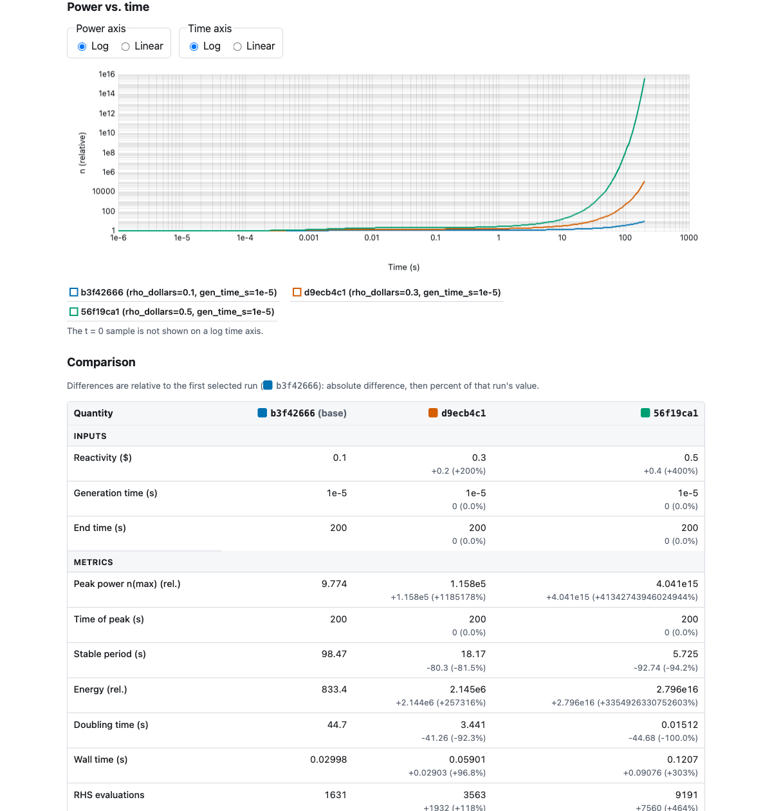

# Compare UI



A static Svelte 5 + TypeScript + Vite + uPlot page for comparing runs of a reactor point-kinetics
parameter sweep. This is an educational point-kinetics model using textbook data, not a design or
safety tool.

Features: sortable and filterable run table (select up to 4 runs), overlay plot of n(t) with
log/linear power and time axes, metric comparison with absolute and percent difference from the
first selected run, parameter scatter (input vs. metric, colored by a third input), and a shareable
URL (`?runs=<id>,<id>`).

## Commands

Node 20.19+ (or 22.12+) is required.

```bash
npm ci               # install
npm run sample-data  # write synthetic data to public/data/ (no Python needed)
npm run dev          # dev server at http://localhost:5173/reactor-kinetics-sweep/
npm run check        # svelte-check, fails on errors and warnings
npm test             # vitest, single run
npm run build        # production build into dist/
npm run preview      # serve dist/ at http://localhost:4173/reactor-kinetics-sweep/
```

The site is built with `base: "/reactor-kinetics-sweep/"` (see `vite.config.ts`) and fetches data
relative to `import.meta.env.BASE_URL`. `public/data/` is gitignored; CI generates it with
`rksweep export`.

## Data contract (schema_version 1)

`public/data/index.json`:

```json
{
  "schema_version": 1,
  "sweep": {"name": "smoke", "sweep_id": "smoke-20261116T120000Z", "design": "grid",
            "input": "step", "data_set": "KEEPIN_U235_THERMAL", "git_sha": "abc1234",
            "created_at": "2026-11-16T12:00:00Z"},
  "runs": [
    {"run_id": "4f1a9c2e77b0", "status": "ok", "error": null,
     "inputs": {"rho_dollars": 0.3, "gen_time_s": 1e-5, "t_end": 200.0},
     "metrics": {"n_max": 12.3, "t_peak": 200.0, "period_s": 21.4, "energy": 512.0,
                 "t_double": 3.2, "wall_time_s": 0.02, "nfev": 310, "njev": 12}}
  ]
}
```

- `status` is `"ok"` or `"failed"`. Failed runs have a string `error`, all-null `metrics`, and no
  series file; they cannot be selected.
- `inputs` keys vary by sweep and are all numbers. Table columns, filters and scatter axes are
  derived from the keys present. Known keys get friendly labels (`src/lib/format.ts`).
- Any metric may be `null` (JSON has no NaN/Infinity). Null renders as an em dash and sorts last.
- If `schema_version` is not 1 the page shows an error instead of rendering.

`public/data/runs/<run_id>.json`: `{"run_id": "...", "t": [0, 1e-6, ...], "n": [1.0, ...]}`,
about 300 points. The first point is t = 0 (dropped on the log time axis); `n > 0` always.

## Layout

```text
src/App.svelte          loads index.json, selection state, URL sync
src/lib/data.ts         fetch, schema checks, diff helpers, query string, filters (unit tested)
src/lib/format.ts       labels and number formatting
src/lib/RunTable.svelte, OverlayPlot.svelte, MetricDiff.svelte, ParamScatter.svelte
scripts/make-sample-data.mjs
```
